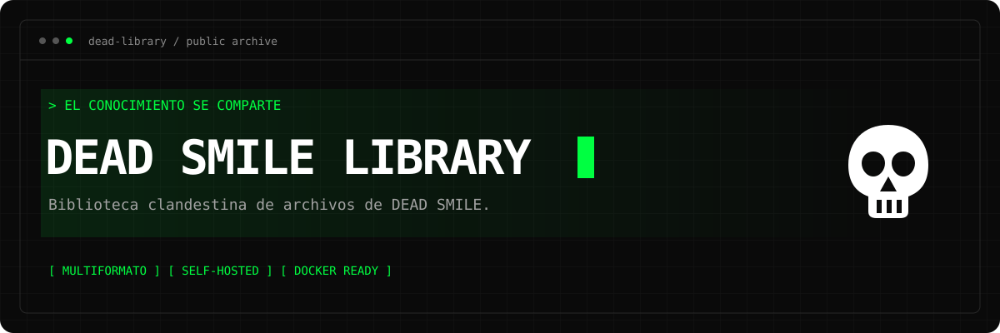

<p align="center">
  
</p>

<p align="center">
  <strong>Biblioteca clandestina de archivos de DEAD SMILE.</strong><br>
  Un archivo digital propio, con estética terminal y sin intermediarios.
</p>

<p align="center">
  
  
  
  
  
</p>

<p align="center">
  <a href="#-qué-incluye">Características</a> ·
  <a href="#-inicio-rápido">Inicio rápido</a> ·
  <a href="docs/DOKPLOY.md">Desplegar en Dokploy</a> ·
  <a href="docs/GITHUB.md">Publicar en GitHub</a> ·
  <a href="SECURITY.md">Seguridad</a>
</p>

---

## ☠ Qué incluye

| Biblioteca pública | Administración |
| --- | --- |
| Catálogo de portadas, títulos, autores y años | Acceso privado desde `/admin` |
| Popup con descripción y datos completos | Subida de varios formatos en una misma obra |
| Descargas EPUB, PDF, TXT y cualquier otro formato | Edición en modal, cambio de portada y descripción |
| Categorías visibles cuando tienen contenido | Gestión de categorías y confirmaciones visuales |
| Orden alfabético o por fecha de subida | Estadísticas de visitas y geolocalización aproximada |
| Modo oscuro/claro, grilla tenue e IBM Plex Mono | Autenticación y credenciales configuradas por entorno |

> **Una obra, varias descargas.** Sube un texto en EPUB y PDF bajo la misma ficha. Sus lectores eligen el formato dentro del popup de detalle.

El repositorio contiene la aplicación. **No incluye la biblioteca personal, archivos subidos, base de datos ni credenciales reales.**

## ⚡ Inicio rápido

Recomendado: **Node.js 24 LTS**. También se admite Node.js ≥ 22.16.

Desde la raíz del repositorio, en PowerShell:

```powershell
npm.cmd ci
Copy-Item .env.example .env
notepad .env
```

Completa `ADMIN_USERNAME` y `ADMIN_PASSWORD` con tus propias credenciales. La contraseña debe tener al menos 12 caracteres y como máximo 72 bytes.

```powershell
npm.cmd start
```

**Biblioteca:** `http://localhost:3000`  
**Administración:** `http://localhost:3000/admin`

En macOS/Linux usa `npm` en lugar de `npm.cmd` y `cp .env.example .env` para crear la configuración.

### Administrador desde `.env`

```dotenv
ADMIN_USERNAME=
ADMIN_PASSWORD=
```

- No existe usuario ni contraseña predeterminados.
- En cada arranque se sincroniza una única cuenta administradora con estas variables.
- SQLite guarda un **hash bcrypt**, nunca la contraseña en texto plano.
- Cambiar las credenciales e iniciar otra vez invalida las sesiones anteriores; reiniciar con las mismas credenciales conserva las sesiones vigentes.
- En Dokploy, estas variables se configuran en **Environment**, sin subir `.env` a GitHub ni incluirlo en la imagen.

Para sincronizar las variables sin iniciar el servidor, con la aplicación detenida:

```powershell
npm.cmd run admin:sync
```

## 🐳 Docker local

Con Docker Desktop/Engine disponible y `.env` completado:

```powershell
docker compose -f docker-compose.local.yml up -d --build
docker compose -f docker-compose.local.yml logs -f library
```

Abre `http://localhost:3000`. Este modo utiliza un volumen propio y publica el puerto **solo en la interfaz local**.

Para detenerlo conservando los datos:

```powershell
docker compose -f docker-compose.local.yml down
```

## 🚀 Dokploy

**Repositorio previsto:** `dead-library`  
**Dominio de producción:** `https://library.deadsmile.org`

El despliegue preparado usa **Docker Compose → `docker-compose.yml`**, un contenedor no-root y un volumen persistente en `/data`. Dokploy administra el dominio, Traefik y el certificado HTTPS.

**[Leer el tutorial completo de Dokploy →](docs/DOKPLOY.md)**

Incluye DNS, conexión con GitHub, variables, subred de confianza, volumen, certificado, actualizaciones, respaldos y migración de una biblioteca existente.

## ⚙ Configuración

| Variable | Descripción |
| --- | --- |
| `ADMIN_USERNAME` | **Obligatoria.** 3–64 letras, números, puntos, guiones o guiones bajos. |
| `ADMIN_PASSWORD` | **Obligatoria.** Mínimo 12 caracteres, máximo 72 bytes. |
| `NODE_ENV` | `development` local; `production` en Dokploy. |
| `PUBLIC_ORIGIN` | Origen exacto del sitio. Producción: `https://library.deadsmile.org`. |
| `PORT` | Puerto interno de Node; por defecto `3000`. |
| `DATA_DIR` | Directorio privado persistente. Node local: `./db`; Docker: `/data`. |
| `SESSION_SECRET` | Secreto aleatorio de al menos 32 bytes. Si se omite, se genera y persiste en el directorio de datos. |
| `TRUST_PROXY` | IP/subred real del proxy controlado. En Dokploy, debe coincidir con la red de Traefik. Vacío cuando no hay proxy. |

Plantillas publicables: [desarrollo](.env.example) · [Dokploy](.env.dokploy.example).

## 💾 Persistencia

```text
/data/                     # En Docker; ./db en Node local
├── library.db             # Catálogo, hash del admin, visitas y sesiones
├── .session-secret        # Secreto generado si no se suministra por entorno
├── .library-lock/         # Lease de escritura de la única instancia
├── uploads/               # Archivos originales
└── covers/                # Portadas procesadas
```

El volumen debe conservarse entre despliegues. **No elimines `library.db` para actualizar ni uses `docker compose down -v` si quieres conservar tu biblioteca.**

La aplicación admite **una instancia escritora**. En Dokploy utiliza una réplica y actualizaciones **stop-first**. Un lease evita escrituras simultáneas; tras una interrupción forzada puede tardar unos 30 segundos en quedar disponible.

## 📚 Límites de contenido

- **250 MB por archivo**, con hasta **100 archivos por envío**; puedes agregar más formatos editando la obra.
- Descargas de cualquier tipo, servidas como adjuntos con tokens aleatorios de 256 bits.
- Portadas JPEG, PNG, GIF o WebP: hasta **8 MB** y **16 millones de píxeles**. Se convierten a WebP estático y se eliminan los metadatos.
- Descripciones de hasta 20 000 caracteres; títulos de hasta 300 y autores de hasta 200.
- Las descargas están en el popup de detalle; no hay visor online.

## 🛡 Seguridad y mantenimiento

Protecciones CSRF, sesiones HttpOnly/SameSite, cookies Secure en producción, límite de intentos, CSP sin JavaScript inline, validación de entradas, subidas privadas y escrituras atómicas.

```powershell
npm.cmd test
npm.cmd audit --omit=dev
```

GitHub Actions prueba la aplicación en **Linux y Windows**, construye la imagen Docker y comprueba inicio, usuario no-root y persistencia. El workflow **no publica imágenes ni realiza despliegues**. Dependabot propone actualizaciones de dependencias.

`GET /healthz` ofrece una comprobación mínima de disponibilidad para Docker sin exponer datos internos.

## 🗂 Estructura

```text
dead-library/
├── .github/               # CI y Dependabot
├── docs/                  # Guías de GitHub/Dokploy y recursos del README
├── lib/                   # Configuración, seguridad, datos y almacenamiento
├── public/                # Catálogo, dashboard, estilos y scripts
├── scripts/               # Healthcheck, sincronización y revisión de Git
├── tests/                 # Integración, seguridad y despliegue
├── Dockerfile
├── docker-compose.yml     # Dokploy / HTTPS mediante Traefik
├── docker-compose.local.yml
└── server.js
```

---

<p align="center">
  <strong>EL CONOCIMIENTO SE COMPARTE.</strong><br>
  <sub>DEAD SMILE LIBRARY · self-hosted digital archive</sub>
</p>
